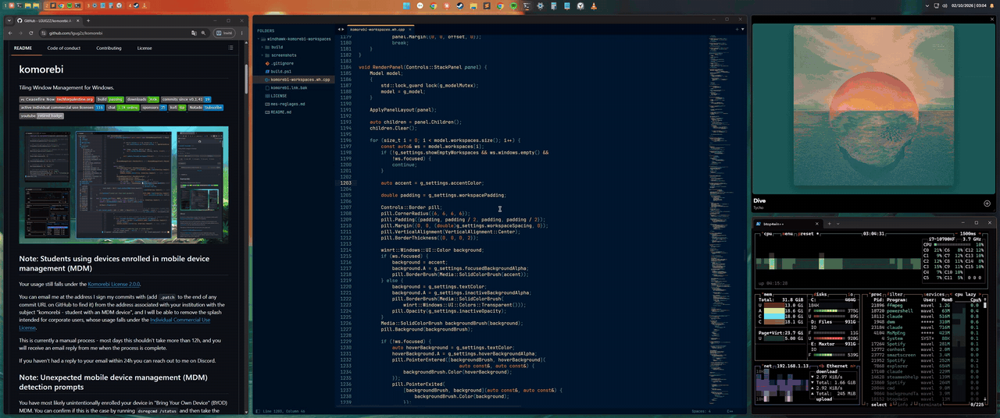
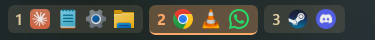
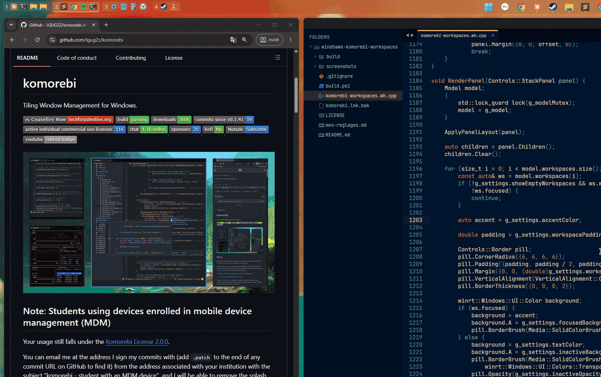
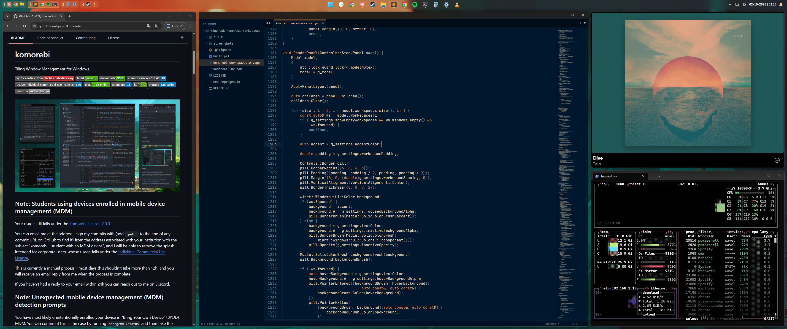

<div align="center">

# Komorebi Workspaces

**A [Windhawk](https://windhawk.net) mod that puts your [komorebi](https://github.com/LGUG2Z/komorebi) workspaces right inside the Windows 11 taskbar.**

No extra status bar, no lost screen space, no z-order fights with the taskbar.



<sub>[Watch in full quality (MP4)](screenshots/demo-zoom.mp4)</sub>

</div>

---

## Why

komorebi users usually run a separate status bar (komorebi-bar, YASB, Zebar…) just to see their workspaces. It costs a strip of screen space, and a bar overlaid on the taskbar ends up hidden behind it as soon as the taskbar is clicked.

This mod draws the workspaces **in the taskbar itself**, as native XAML elements next to the regular taskbar buttons. They look and behave like part of Windows.

## Features

| | |
|---|---|
| 🗂️ **Workspaces** | The workspaces of the taskbar's monitor, with the focused one highlighted |
| 🪟 **Window icons** | The icons of the windows in each workspace, with titles in tooltips. Store (UWP) apps included |
| 🖱️ **Click** | Click a workspace to focus it, click an icon to jump to that window |
| ❌ **Middle click** | Middle click an icon to close the window |
| 🛞 **Scroll** | Scroll over the workspaces to cycle through them |
| 📍 **Placement** | Left, center or right of the taskbar, with an adjustable offset |
| 🎨 **Styling** | Sizes, spacing, font, colors, and the opacity of each state |
| ⚡ **Live** | Event-driven through komorebi's named pipe subscription, no polling. Reconnects when komorebi restarts |







## Requirements

- Windows 11 with the new (XAML) taskbar
- [Windhawk](https://windhawk.net)
- [komorebi](https://github.com/LGUG2Z/komorebi), installed and running

For the default left placement, centering the taskbar icons and turning off the Widgets button leaves the left side of the taskbar free (*Settings → Personalization → Taskbar*).

## Installation

### From Windhawk (once the mod is published)

Open Windhawk, search for **Komorebi Workspaces** and click **Install**.

### From source

1. Open Windhawk and click **Create a new mod**.
2. Replace the editor content with [`komorebi-workspaces.wh.cpp`](komorebi-workspaces.wh.cpp).
3. Click **Compile Mod**, then **Exit editing mode**.

The workspaces appear on the next taskbar layout, or as soon as you hover a taskbar button.

## Settings

| Setting | Default | Description |
|---|---|---|
| Position | Left | Left, center or right of the taskbar |
| Horizontal offset | `8` | Distance from the taskbar edge, or shift from the center |
| Show empty workspaces | Off | The focused workspace is always shown |
| Show workspace names | On | Names from the komorebi config, or numbers when off |
| Show window icons | On | |
| Maximum icons per workspace | `0` | Extra windows become a `+N` counter (0 for no limit) |
| Scroll to switch workspaces | On | |
| Icon size / Font size | `20` / `15` | |
| Font family | *(taskbar font)* | Any installed font, e.g. `Cascadia Code` |
| Workspace padding / spacing | `8` / `6` | Inside and between workspace tiles |
| Accent color | `#faa968` | Focused workspace, `#RRGGBB` or `#AARRGGBB` |
| Text color | `#f6dcac` | Workspace labels |
| Opacities | `90` / `30` / `12` / `25` | Unfocused workspace, focused background, unfocused background, hover background |
| komorebic path | `C:\Program Files\komorebi\bin\komorebic-no-console.exe` | Change it if komorebi is installed elsewhere |

Settings apply immediately, with no need to recompile.

### Tip: komorebi's `mouse_follows_focus`

When switching workspaces, komorebi moves the mouse cursor to the focused window by default. If the cursor jumping away from the taskbar bothers you, set this in `komorebi.json`:

```json
"mouse_follows_focus": false
```

## How it works

```
 komorebi ──(named pipe, JSON per event)──▶ mod thread in explorer.exe
                                                  │ parse state, load icons
                                                  ▼
                              taskbar UI thread: XAML panel in TaskbarFrame
                                                  │ click / scroll
                                                  ▼
                                    komorebic focus-monitor-workspace …
```

- **Injection.** The mod hooks `TaskbarFrame::MeasureOverride` and `TaskListButton::UpdateVisualStates` in `Taskbar.View.dll` to find each taskbar's `TaskbarFrame`. It then adds a `StackPanel` to the frame's root grid.
- **State.** A background thread creates a named pipe and runs `komorebic subscribe-pipe`. komorebi then writes one JSON notification per line, each holding the full window manager state. The initial state comes from `komorebic state`.
- **Icons.** Icons come from `WM_GETICON` and the window class, falling back to the executable's icon. Store apps hosted by `ApplicationFrameHost.exe` get their icon through their AppUserModelID. Icons are rendered to premultiplied BGRA and shown as `WriteableBitmap`s.
- **Actions.** Clicks and scrolls run `komorebic` on a background thread, so the taskbar never blocks.

## Development

`build.ps1` compiles the mod with Windhawk's bundled clang and the same flags as the Windhawk editor. It's a quick way to check that the mod builds:

```powershell
.\build.ps1
```

To try changes, paste the source into the Windhawk editor and compile there. Enable logging in the editor to see the mod's `Wh_Log` output.

## Known limitations

- **Multiple monitors:** every taskbar currently shows the workspaces of the monitor of the main taskbar.
- **Insider builds:** like every taskbar mod, the mod depends on internal taskbar code, which Windows updates can change.

## Credits

- [komorebi](https://github.com/LGUG2Z/komorebi) by LGUG2Z
- [Windhawk](https://windhawk.net) by m417z, whose taskbar mods were the reference for the hooking techniques

## License

[MIT](LICENSE)
